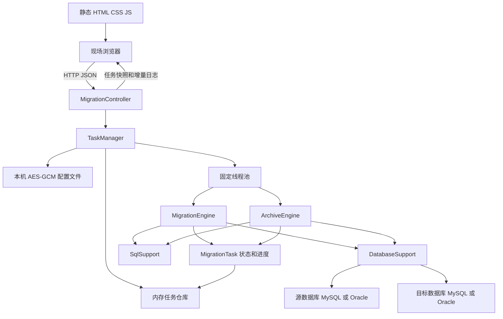
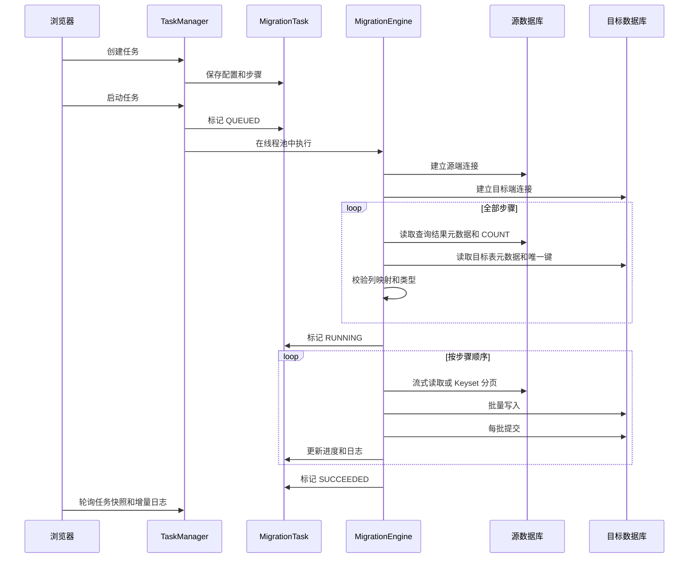
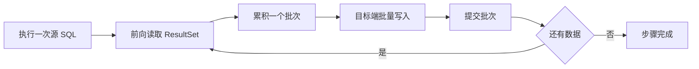
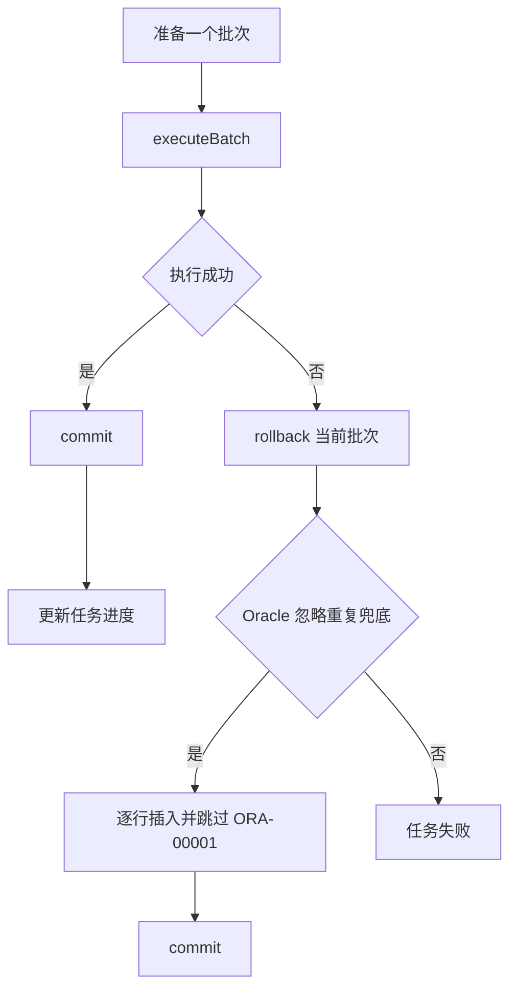
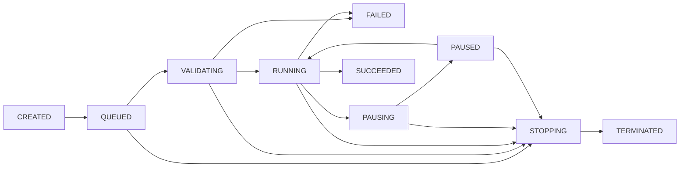

# Light DB Migration 开发人员设计说明

## 1. 文档目的

本文面向接手维护、问题定位和二次开发 Light DB Migration 的开发人员，说明项目定位、技术栈、模块架构、核心迁移流程、事务与并发模型、接口约定、扩展方式及当前边界。

现场安装、页面操作和故障处理请参阅 [现场实施操作手册](现场实施操作手册.md)；真实 MySQL、Oracle 环境的验证范围请参阅 [现场实测报告](现场实测报告.md)。

## 2. 项目定位与设计原则

Light DB Migration 是一个面向现场实施人员的轻量级数据库迁移服务。服务启动后，源端和目标端连接、查询 SQL、批次大小、写入策略、任务控制、进度及日志均由浏览器页面管理，不依赖服务端业务配置文件，也不使用存储过程。

当前版本遵循以下原则：

- 单 Jar 部署，JDK 8 即可运行，不要求 Node.js、独立 Web 容器或外部任务数据库。
- 使用标准 JDBC 完成元数据读取、查询和写入，不引入 ORM、连接池及调度平台。
- 每个迁移任务持有独立的源端、目标端连接配置，多个任务可以并行运行。
- 一个任务内的多条迁移 SQL 严格按配置顺序执行。
- 所有步骤先完成结构预检，再开始任何目标端写入，尽量在迁移前暴露配置问题。
- 普通查询使用流式读取；页面指定递增唯一游标时使用带上界的 Keyset 分页，不依赖 JDBC 数值类型或数据库自增元数据，也不使用 OFFSET 深分页。
- 目标端按批次提交。暂停和终止是协作式控制，已经提交的批次不会回滚。
- 默认跳过唯一键冲突；MySQL 和 Oracle 根据数据库能力采用不同实现。
- 任务状态、进度和页面日志只保存在进程内存中；最近一次两端连接配置使用 AES-GCM 加密文件保存，服务重启后可回填，但不恢复任务。

## 3. 技术栈

| 层次 | 技术或版本 | 用途 |
| --- | --- | --- |
| 运行环境 | JDK 8 | 现场运行基线 |
| 构建工具 | Maven 3.6.3+、Assembly Plugin 3.8.0 | 依赖管理、可执行 Jar 和完整现场交付 ZIP 打包 |
| 后端框架 | Spring Boot 2.7.18 | HTTP 服务、静态资源、JSON 序列化、嵌入式 Tomcat |
| 数据访问 | JDBC | 连接、元数据读取、流式查询、批量写入和事务控制 |
| MySQL 驱动 | mysql-connector-j 8.0.33 | MySQL 连接与批量写入 |
| Oracle 驱动 | ojdbc8 19.22.0.0 | Oracle 连接、查询及 MERGE 写入 |
| 日志 | SLF4J + Logback | 服务日志和异常堆栈；由 Spring Boot 默认日志实现提供 |
| 前端 | 原生 HTML、CSS、JavaScript | 离线页面、表单管理、任务控制、状态轮询 |
| 数据交换 | HTTP + JSON | 浏览器与后端交互 |
| 配置保护 | JCA AES-GCM + 本地文件 | 加密保存最近一次两端数据库配置和密码 |

项目没有引入 MyBatis、JPA、数据库连接池、Vue/React、WebSocket、消息队列或外部持久化组件。这样可以缩小部署体积和现场依赖面，但也意味着连接和任务生命周期均由项目自身管理。

## 4. 工程目录

```text
LightDbMigration
|-- pom.xml
|-- README.md
|-- start.bat
|-- start.sh
|-- docs
|   |-- 开发人员设计说明.md
|   |-- 现场实施操作手册.md
|   |-- 现场实测报告.md
|   `-- 变更审阅清单.md
|-- src
|   |-- assembly
|   |   `-- distribution.xml       # 现场交付 ZIP 组成
|   |-- main
|   |   |-- java/com/hundsun/lightdbmigration
|   |   |   |-- LightDbMigrationApplication.java
|   |   |   |-- controller
|   |   |   |-- model
|   |   |   |-- service        # 含 LastDatabaseConfigStore
|   |   |   `-- support
|   |   `-- resources
|   |       |-- application.properties
|   |       `-- static
|   |           |-- index.html
|   |           |-- app.css
|   |           `-- app.js
|   `-- test
|       `-- java/com/hundsun/lightdbmigration
|           |-- LiveDatabaseIntegrationCheck.java
|           |-- service/LastDatabaseConfigStoreCheck.java
|           `-- support/DatabaseSupportTimeoutCheck.java
|-- data                          # 运行期生成，Git 忽略
|   |-- last-config.key
|   `-- last-database-config.dat
`-- target
    |-- light-db-migration.jar
    `-- light-db-migration-1.2.0.zip
```

核心包职责如下：

| 包 | 主要类 | 职责 |
| --- | --- | --- |
| `controller` | `MigrationController`、`ApiExceptionHandler` | REST 接口、统一成功响应和异常转换 |
| `model` | `DatabaseConfig`、`CreateTaskRequest`、`MigrationStepRequest`、`ArchiveRequest`、`ArchiveTableRequest`、`ArchiveRelationRequest`、`TaskStatus`、`StepProgress` | 迁移/归档入参、任务状态及进度模型 |
| `service` | `TaskManager`、`MigrationTask`、`MigrationEngine`、`ArchiveEngine`、`LastDatabaseConfigStore` | 任务管理、状态控制、迁移/归档执行、最近配置加密持久化 |
| `support` | `DatabaseSupport`、`SqlSupport`、`MigrationConstants` | JDBC 连接、SQL 安全处理、数据库差异和公共常量 |
| `resources/static` | `index.html`、`app.css`、`app.js` | 无外部依赖的现场操作页面 |

## 5. 总体架构



前端和后端随同一个 Jar 发布。Spring Boot 将 `resources/static` 下的页面直接映射为静态资源，浏览器通过 `/api` 下的接口完成配置和控制。后端不依赖独立数据库保存任务，只在本机 `data` 目录保存一份最近数据库连接配置的密文和密钥。

### 5.1 请求层

`MigrationController` 只负责接收请求并调用 `TaskManager` 或 `DatabaseSupport`，不承载迁移规则。正常响应统一为：

```json
{
  "success": true,
  "data": {}
}
```

参数、状态或执行错误由 `ApiExceptionHandler` 转换为：

```json
{
  "success": false,
  "message": "可展示给现场人员的错误信息"
}
```

错误信息通过 `SqlSupport.safeMessage` 清理，避免把 JDBC URL 中可能包含的认证信息原样返回页面。

### 5.2 任务管理层

`TaskManager` 使用 `ConcurrentHashMap` 保存任务，使用固定大小线程池执行任务。创建任务时根据 `taskType` 校验迁移或归档参数并更新最近连接配置密文，启动后将任务提交到 `MigrationEngine` 或 `ArchiveEngine`。归档模式把目标配置规范化为源配置，保证所有写入和删除使用同一个数据库连接。

`LastDatabaseConfigStore` 使用每次首次保存时生成的 128 位 AES 密钥和 12 字节随机 IV，以 `AES/GCM/NoPadding` 加密 JSON。密钥与密文分别原子替换，避免写入中断留下半文件；POSIX 文件系统尝试设置为仅属主读写，Windows 沿用目录 ACL。该设计防止明文误读，但密钥与密文同机存放，不抵御能够读取整个运行目录的本机用户。

主要限制定义在 `MigrationConstants`：

| 常量 | 当前值 | 作用 |
| --- | ---: | --- |
| `EXECUTOR_SIZE` | 4 | 同时工作的迁移线程数 |
| `MAX_TASKS` | 100 | 内存中保留的任务上限 |
| `MAX_STEPS` | 50 | 单任务最大迁移步骤数 |
| `DEFAULT_BATCH_SIZE` | 1000 | 未指定时的默认批次大小 |
| `MIN_BATCH_SIZE` | 1 | 最小批次大小 |
| `MAX_BATCH_SIZE` | 10000 | 最大批次大小 |
| `MAX_ARCHIVE_BATCH_SIZE` | 500 | 归档主表最大批次，控制关联参数和单批事务规模 |
| `MAX_ARCHIVE_RELATIONS` | 5 | 单张子表最大复合关联字段数 |
| `MAX_TASK_LOGS` | 5000 | 单任务保留的页面日志条数 |
| `CONNECTION_TIMEOUT_SECONDS` | 15 | 数据库建连等待上限 |

任务超过线程池容量时保持 `QUEUED`，待工作线程空闲后执行。多个任务之间没有共享数据库连接或事务。

### 5.3 任务状态对象

`MigrationTask` 是单个任务的内存状态容器，保存：

- 脱敏后的任务展示信息及执行期间所需的数据库配置。
- 当前任务状态、开始时间、结束时间和当前提示。
- 总行数、已处理行数及每个步骤的进度。
- 暂停、终止控制标记。
- 当前正在执行的 JDBC `Statement` 集合。
- 最多 5000 条的任务内日志环形保留区。
- 结构预检失败时生成的目标表结构同步建议脚本，仅在任务详情接口返回。

任务结束、删除或服务关闭时会调用 `clearPasswords` 清空任务内存对象中的数据库密码。普通任务快照只返回数据库类型、地址和用户名，不返回密码；只有 `GET /api/config/last` 会在受信任页面请求时解密返回最近配置，响应强制 `Cache-Control: no-store`。

### 5.4 迁移执行层

`MigrationEngine` 是核心执行器，负责：

- 建立源端和目标端连接。
- 对全部步骤执行 SQL、列、类型、目标约束及游标预检。
- 统计总行数并初始化任务进度。
- 选择流式读取或 Keyset 分页。
- 根据目标数据库和写入模式生成批量 SQL。
- 控制批次事务、重复数据处理、暂停、终止和异常收尾。

`MigrationEngine` 不保存跨进程断点；每次启动任务都从查询起点重新执行，依赖默认的忽略重复策略保证可重跑性。

`ArchiveEngine` 是独立的同库归档执行器。一个任务可配置多张主业务表，每张主表作为独立根节点并按配置顺序执行；从表只能选择一个主表或从表作为直接上级。执行器强制归档表与源表字段数量、名称、JDBC 类型、精度、标度和可空性一致，主表查询必须覆盖源表全部字段。归档分为两种分页模式：配置游标时，将该字段视为递增唯一键并使用固定上界 Keyset；留空时通过 `DatabaseMetaData.getPrimaryKeys` 取得单列主键，但只将其作为稳定排序和精确删除键，每批删除后重新读取当前首批，不执行 `MAX / > / <=`。无主键或复合主键表要求手工填写游标。归档不复用迁移的重复忽略逻辑，始终使用严格 `INSERT`。

## 6. 核心迁移流程

### 6.1 任务执行总流程



执行顺序为：

1. 检查暂停、终止标记，并记录任务开始。
2. 建立源端连接，尽量设置只读模式。
3. 建立目标端连接并关闭自动提交。
4. 按配置顺序预检所有迁移步骤。
5. 汇总各步骤 `COUNT` 结果，设置总进度。
6. 按配置顺序逐条执行迁移步骤。
7. 每个批次写入成功后提交并更新进度。
8. 全部步骤成功后将任务标记为 `SUCCEEDED`。
9. 终止或异常时回滚当前尚未提交的批次，关闭连接并清空密码。

关键约束是“全部预检成功后才写入”。例如任务有三条 SQL，第三条目标表结构不兼容时，第一、第二条也不会提前迁移。

### 6.2 结构预检

每个步骤的预检由 `prepareStep` 完成，主要过程如下：

1. 校验源 SQL 只允许以 `SELECT` 或 `WITH` 开头。
2. 移除末尾分号，拒绝中间分号和 JDBC `?` 占位符。
3. 校验目标表名仅允许 `表名` 或 `模式名.表名`。
4. 使用零行包装查询读取源 SQL 的结果集元数据。
5. 使用零行查询读取目标表元数据。
6. 按不区分大小写的列名进行映射，拒绝重复列标签。
7. 校验源列在目标表中存在，并检查类型族、文本长度和数值容量。
8. 检查未参与映射的目标必填列是否具有默认值、自增能力或允许为空。
9. 如果页面配置了游标列，只检查该列存在，不读取或依赖 `isAutoIncrement`，也不限制 JDBC 类型。
10. 包装源 SQL 执行统计，记录步骤总行数；游标列在同一次查询中检查非空行数和唯一值数量；存在可能缩窄的固定整数列时继续合并校验实际最小值、最大值和非整数值数量。
11. 读取目标主键和唯一索引，为 Oracle 忽略重复策略选择可用键。
12. 生成目标写入 SQL，形成只在本次执行中使用的 `PreparedStep`。

预检采用问题收集模式。字段缺失、类型不兼容、目标必填字段、游标配置和数值实际范围等问题加入有序集合；同一步骤继续检查其他字段，当前步骤失败后继续下一条 SQL。所有步骤结束后统一输出编号问题清单并抛出汇总异常。用户终止、线程中断及 SQLState 08 类连接故障不参与汇总，会立即向上抛出。

只要存在校验问题，`MigrationEngine` 同时生成目标库 DDL 建议并写入 `MigrationTask.structureSyncScript`。任何目标写入仍然不会发生。

元数据读取使用的逻辑 SQL 形态为：

```sql
SELECT * FROM (<source_sql>) LM_SOURCE WHERE 1 = 0
```

```sql
SELECT * FROM <target_table> WHERE 1 = 0
```

没有游标且没有待检查数值范围时，总行数统计使用：

```sql
SELECT COUNT(*) FROM (<source_sql>) LM_STATS
```

配置游标后，同一条统计 SQL 增加：

```sql
SELECT COUNT(*),
       COUNT(LM_STATS.<cursor_column>),
       COUNT(DISTINCT LM_STATS.<cursor_column>)
FROM (<source_sql>) LM_STATS
```

若 Oracle `NUMBER`、MySQL `DECIMAL` 或浮点列准备写入固定整数目标，且声明元数据不能证明目标范围完整覆盖源范围，统计 SQL 会扩展为一次聚合：

```sql
SELECT COUNT(*),
       MIN(LM_STATS.<column>),
       MAX(LM_STATS.<column>),
       SUM(CASE
               WHEN LM_STATS.<column> IS NOT NULL
                AND LM_STATS.<column> <> FLOOR(LM_STATS.<column>)
               THEN 1 ELSE 0
           END)
FROM (<source_sql>) LM_STATS
```

只对需要的列增加聚合表达式，所有列仍合并在一条 SQL 中，不会在字段循环中逐列查询。对大表或复杂关联，统计可能成为预检阶段的主要耗时，需要开发人员在优化时保留对现场进度可解释性的权衡。

### 6.3 列映射和类型兼容

当前版本按源查询结果的列标签映射到目标表同名列，不提供页面级列名映射表达式。需要改名或类型转换时，应在源 SQL 中使用别名或数据库转换函数，例如：

```sql
SELECT source_id AS id, CAST(source_value AS CHAR) AS value_text
FROM source_table
```

类型校验先将 JDBC 类型归并为数字、文本、时间、二进制四类，再做有限的容量检查：

- 类型族必须兼容，避免把二进制直接写入数值列等明显错误。
- 文本目标长度不能小于源端声明长度。
- 精确十进制目标继续比较整数位数和小数位数。
- `TINYINT`、`SMALLINT`、`MEDIUMINT`、`INTEGER`、`BIGINT`、`BIT`、`BOOLEAN` 按真实上下界判断，包含 MySQL `UNSIGNED` 范围。
- 当源字段的声明范围大于固定整数目标，但本次查询实际值仍在目标范围内时允许迁移；超界值和非整数值在任何目标写入前被拦截。
- `FLOAT`、`REAL`、`DOUBLE` 的 JDBC precision 可能表示有效位或二进制精度，不再与 `NUMBER/DECIMAL` 的十进制 precision 直接比较。
- 无法准确归类的 JDBC 类型需要谨慎验证，必要时在源 SQL 中显式转换。

例如 Oracle `NUMBER(20,0)` 的声明范围大于 MySQL 有符号 `BIGINT`，不能仅因目标 JDBC precision 为 19 就直接判定失败。工具会检查本次源查询的实际 `MIN/MAX`：最大值不超过 `9223372036854775807` 且最小值不低于 `-9223372036854775808` 时校验通过，否则在迁移前失败。相同机制也覆盖“位数相同但范围不同”的 `NUMBER(19,0) -> BIGINT`、`NUMBER(3,0) -> TINYINT` 以及 MySQL `MEDIUMINT`。

该检查是预检时点的数据范围判断，不等价于跨库快照。若预检后源数据发生变化，新出现的超界值仍会由目标数据库写入阶段拦截。字符集、时区、特殊数值及驱动私有类型仍应通过专项测试确认。

### 6.4 表结构同步脚本生成

同步脚本只是一份审核材料，不是自动修复机制。生成器使用源查询的 `ResultSetMetaData` 和目标数据库类型推导：

- 缺失列：MySQL 生成 `ALTER TABLE ... ADD COLUMN`，Oracle 生成 `ALTER TABLE ... ADD (...)`。
- 类型或容量问题：生成目标方言的 `MODIFY` 建议。
- 明确识别 MySQL 1146、SQLState 42S02 或 Oracle ORA-00942 时，基于全部源列生成候选 `CREATE TABLE`。
- 不可安全推导的问题只写注释，不生成危险 DDL。

类型映射以避免缩窄为优先：精确数值优先映射为 MySQL `DECIMAL(p,s)` 或 Oracle `NUMBER(p,s)`；大文本映射为 `LONGTEXT/CLOB/NCLOB`；二进制映射为 `LONGBLOB/BLOB`；时间类型按目标方言生成。超过数据库能力或 JDBC 元数据不明确时返回人工处理注释。

脚本安全约束：

- 不包含数据库密码和源查询 SQL。
- 表名、字段名使用目标数据库引用符，Oracle 标识符按未加引号语义转为大写。
- 不生成删除字段、删除约束或自动放宽非空约束的语句。
- 新增字段默认可空，避免目标表已有数据导致直接失败；后续非空及默认值由 DBA 决定。
- MySQL `MODIFY COLUMN` 前附加属性丢失风险提示。
- 脚本仅保存在任务内存，服务重启后清空。

## 7. 两种源端读取模式

### 7.1 流式读取

未配置游标列时，整个源查询只创建一个前向只读 `PreparedStatement`，并设置 `fetchSize`。执行器逐行读取结果，累计到批次大小后一次写入目标端。



优点是不会为每一页重复执行源查询，也不会使用 OFFSET。缺点是长时间迁移期间源端游标一直存在，对网络稳定性和数据库游标资源有要求。

### 7.2 Keyset 游标分页

页面配置游标列时，迁移开始先查询当前结果集的游标最大值作为上界，随后使用 `游标 > 上次值 AND 游标 <= 上界` 逐页读取，并按源数据库对该字段的升序规则排序。是否启用完全由页面配置决定，不检查数据库字段自增标记，也不限制数值类型。

MySQL 查询形态：

```sql
SELECT *
FROM (<source_sql>) LM_PAGE
WHERE <cursor_column> > ?
  AND <cursor_column> <= ?
ORDER BY <cursor_column>
LIMIT <batch_size>
```

Oracle 查询形态：

```sql
SELECT *
FROM (
    SELECT *
    FROM (<source_sql>) LM_PAGE
    WHERE <cursor_column> > ?
      AND <cursor_column> <= ?
    ORDER BY <cursor_column>
)
WHERE ROWNUM <= <batch_size>
```

首批没有“上一游标”条件。固定上界使迁移开始后新增的更大游标数据不进入本次任务，避免任务追赶不断增长的数据集。预检使用 `COUNT` 和 `COUNT(DISTINCT ...)` 一次性确认本次结果非空且唯一；运行时仍防御空值、重复值和游标未推进。

游标模式适用于按数据库比较规则单调递增、唯一、非空且支持 `MAX`、`>`、`<=`、`ORDER BY` 的字段。它可以是数据库自增整数，也可以是应用算法生成的递增字符串 UUID/ID；普通随机 UUID、重复字段、可能回退的业务编码和 LOB 不应配置为游标。Java 端不再用 `String.compareTo` 判断数据库排序，分页推进和结束以数据库条件、批次数及上界相等为准，避免字符排序规则差异导致误判。

## 8. 目标端写入策略

### 8.1 默认忽略重复

页面默认写入模式为 `IGNORE_DUPLICATE`。

MySQL 直接生成：

```sql
INSERT IGNORE INTO <target_table> (<columns>) VALUES (?, ?, ...)
```

Oracle 不支持 `INSERT IGNORE`，因此分两种路径：

- 如果目标表存在由本次写入列完整覆盖的主键或唯一键，生成 `MERGE INTO ... WHEN NOT MATCHED THEN INSERT`，批量执行时直接跳过匹配记录。
- 如果没有可用的完整唯一键，先批量执行普通 `INSERT`。仅在出现重复键异常时回滚当前批次，然后逐行重试该批次，跳过 `ORA-00001`，其他异常继续抛出。

Oracle 逐行重试是异常兜底路径，不是正常路径。它会增加数据库往返次数，因此目标表应优先建立合理的主键或唯一索引。

### 8.2 严格写入

`STRICT_INSERT` 生成普通 `INSERT`。任何批次错误都会回滚当前未提交批次并使任务失败，适合要求重复数据必须被识别为异常的场景。

### 8.3 批次事务

目标连接设置 `autoCommit=false`，每个成功批次显式 `commit`。发生错误、终止或线程中断时只对当前尚未提交的批次执行 `rollback`。



这是一种吞吐量和可控制性之间的折中：批次越大，数据库往返次数越少，但单批内存占用、失败重试成本以及暂停响应时间越高。

## 8A. 同库归档执行模型

归档先确定全部主表和从表的分页模式。页面填写游标时，按该表游标做 Keyset 分页并固定任务开始时的上界；留空时读取源表单列主键作为删除键，按该键排序读取当前首批，提交删除后再次从剩余范围读取首批。多张主表构成归档森林，按 `mainTables` 顺序逐棵执行。每个主表批次包含以下操作：

1. 读取当前主表批次并严格批量写入主归档表。
2. 从表配置形成以一个 `MAIN_n` 为根的单上级有向无环关系。后端在执行前校验全部主/从节点唯一性、物理表不重复、上级存在性和无环性，并按父节点优先拓扑排序。
3. 从当前父节点批次提取下级从表配置的父表关联字段值并去重；空的复合关联键不参与匹配。单字段关联生成参数化 `IN`，复合字段关联生成参数化等值条件组。
4. 每张从表按自身游标分页。写入当前从表归档记录后，递归处理它的全部下级节点；最深层完成后再按游标集合删除当前源表记录。
5. 每次删除父节点前重新统计其直接下级源记录，非零则回滚当前主表批次。
6. 按主表游标集合删除源主表，校验写入数、删除数均等于本批读取数。
7. 执行一次 `commit`，之后才更新页面进度和批次日志。

以 `主表 → 从表A → 从表B` 为例，归档侧写入顺序为主表、A、B，源侧删除顺序为 B、A、主表，可覆盖多级双侧外键约束。一个节点可以有多张下级表，但每个从表只允许一个直接上级，当前不支持多入边汇聚节点。任何异常、数量不一致、重复键、暂停后的终止或线程中断都会回滚当前主表批次。此前已提交批次（包括前一张主表的批次）不回滚，因此归档任务仍不是跨主表或全任务大事务。

归档没有逐行 SQL：主表/从表写入均使用 JDBC batch，删除使用一批游标值的 `IN`；每一级从表按上级数据批次执行关联分页查询。归档批次上限 500，用于限制 Oracle/MySQL 绑定参数数量、SQL 长度、递归分页内存和单批事务规模。

归档所有应用侧 SQL 在执行前通过 `MigrationTask.backendSql` 直接写入 SLF4J，不调用 `appendLog`，因此不会进入任务详情接口或前端日志面板。结构探测、范围统计、游标上界、分页查询、下级残留统计和源表删除记录 SQL 文本及绑定参数；删除参数最多展开 50 个，单个文本值最多 160 字符，二进制只记录长度。JDBC batch 写入记录完整 SQL 模板和批量行数，不逐行展开业务字段值。`DatabaseMetaData.getPrimaryKeys` 属于驱动元数据 API，无法取得驱动内部 SQL 原文，只记录其解析结果。

关键并发边界：批次提交会释放数据库快照和锁，工具无法阻止业务在后续批次修改归档范围。正式归档必须在停写或维护窗口执行；删除数量一致校验是防御措施，不是在线一致性方案。

## 9. 数据读取与 JDBC 绑定

源结果读取时对大字段做了显式物化：

- `CLOB`、`NCLOB`、长文本及 `SQLXML` 转为 Java `String`。
- `BLOB`、二进制及长二进制转为 `byte[]`。
- 其他类型使用 `ResultSet.getObject`。

目标写入通过 `PreparedStatement` 按目标列 JDBC 类型绑定。大字段会随当前批次保存在 JVM 内存中，因此包含大 CLOB/BLOB 时应降低批次大小，并结合目标数据库日志空间评估。

## 10. 状态机、暂停与终止

### 10.1 任务状态



终态为 `TERMINATED`、`SUCCEEDED`、`FAILED`。仅未运行或已进入终态的任务允许删除。

### 10.2 暂停

暂停采用协作式检查点：

1. 页面请求暂停后，设置 `pauseRequested`，任务显示 `PAUSING`。
2. 工作线程运行到下一个 `checkpoint` 后进入 `PAUSED` 并等待。
3. 页面请求继续后清除暂停标记并唤醒工作线程。

检查点位于建连、预检、分页和批次边界等关键位置。JDBC 驱动正在执行一次不可中断的数据库操作时，暂停不会瞬间生效。

### 10.3 终止

终止时设置 `stopRequested`，唤醒可能正在暂停的线程，并对当前登记的 JDBC `Statement` 调用 `cancel`。工作线程在检查点或收到 JDBC 取消异常后结束，当前未提交批次回滚，已提交批次保留。

因此当前“终止”不是全任务事务回滚，也不是迁移后恢复。页面和操作手册必须继续明确这一边界。

## 11. 并发与线程安全

- 任务仓库使用 `ConcurrentHashMap`，允许页面轮询与后台执行并发访问。
- 状态、时间、计数等高频读取字段使用 `volatile` 或原子类；批次统计更新使用同步方法。
- 暂停和继续通过独立监视器的 `wait/notifyAll` 协作。
- 活跃 JDBC 语句使用并发集合登记，以便终止请求尝试取消。
- 任务日志使用 `ConcurrentLinkedDeque`，配合递增序号支持前端增量拉取。
- 执行线程池固定为 4 个守护线程。一个任务通常长期占用一个工作线程和两条数据库连接。

当前没有按数据库地址限流。若多个任务同时访问同一生产源库，仍可能叠加查询和网络压力，现场并发数量应受数据库承载能力约束。

## 12. 数据库连接设计

`DatabaseSupport` 支持表单参数和完整 JDBC URL 两种输入方式。完整 URL 会检查协议，且拒绝在 URL 中携带 `user`、`password` 等认证参数；用户名和密码始终通过 JDBC `Properties` 传入。

### 12.1 MySQL

表单模式生成的 URL 包含 UTF-8、Asia/Shanghai 时区、批量重写、服务端预编译、游标抓取及连接超时参数。默认端口为 3306。

### 12.2 Oracle

支持 Service Name 和 SID 两种地址形式，默认端口为 1521：

```text
jdbc:oracle:thin:@//host:port/serviceName
jdbc:oracle:thin:@host:port:SID
```

### 12.3 建连超时

除 JDBC URL 和 `DriverManager` 超时外，连接动作还在线程中执行并通过 `Future.get` 设置 15 秒看门狗。即使某些驱动忽略线程中断，接口也会在上限附近返回；如果迟到的连接随后建立，守护逻辑会主动关闭它，避免泄漏。

连接测试分别执行 `SELECT 1` 或 `SELECT 1 FROM DUAL`，并返回数据库产品、版本和耗时。首次连接失败时，调用方不应自动重试，以免现场网络或账号策略触发封禁。

## 13. REST 接口

所有接口前缀为 `/api`。

| 方法 | 路径 | 作用 |
| --- | --- | --- |
| `GET` | `/api/system` | 查询系统限制和支持能力 |
| `POST` | `/api/connections/test` | 测试单个数据库连接 |
| `GET` | `/api/config/last` | 解密返回最近一次两端配置，响应禁止缓存 |
| `POST` | `/api/config/last` | 校验并加密保存当前两端配置 |
| `DELETE` | `/api/config/last` | 删除最近配置密文和密钥 |
| `POST` | `/api/tasks` | 创建迁移或归档任务（不会立即启动） |
| `GET` | `/api/tasks` | 获取任务摘要列表 |
| `GET` | `/api/tasks/{id}?afterLog=0` | 获取任务详情和指定序号后的日志 |
| `POST` | `/api/tasks/{id}/start` | 启动任务 |
| `POST` | `/api/tasks/{id}/pause` | 请求暂停 |
| `POST` | `/api/tasks/{id}/resume` | 继续执行 |
| `POST` | `/api/tasks/{id}/terminate` | 请求终止 |
| `DELETE` | `/api/tasks/{id}` | 删除未启动或已结束任务 |

创建任务请求示例：

```json
{
  "taskType": "MIGRATION",
  "name": "客户资料迁移",
  "batchSize": 1000,
  "source": {
    "type": "MYSQL",
    "host": "127.0.0.1",
    "port": 3306,
    "database": "source_db",
    "username": "source_user",
    "password": "******"
  },
  "target": {
    "type": "ORACLE",
    "host": "127.0.0.1",
    "port": 1521,
    "database": "orcl",
    "oracleMode": "SERVICE",
    "username": "target_user",
    "password": "******"
  },
  "steps": [
    {
      "name": "迁移客户主表",
      "sourceSql": "SELECT id, customer_name, created_at FROM customer_source",
      "targetTable": "CUSTOMER_TARGET",
      "cursorColumn": "id",
      "insertMode": "IGNORE_DUPLICATE"
    }
  ]
}
```

归档任务请求示例（`target` 可与 `source` 相同，服务端归档时只使用同一个源连接）：

```json
{
  "taskType": "ARCHIVE",
  "name": "历史业务归档",
  "batchSize": 500,
  "source": {
    "type": "MYSQL",
    "host": "127.0.0.1",
    "port": 3306,
    "database": "business_db",
    "username": "archive_user",
    "password": "******"
  },
  "archive": {
    "confirmSourceDelete": true,
    "mainTables": [
      {
        "name": "主业务表一",
        "nodeId": "MAIN_1",
        "sourceTable": "BUSINESS_MAIN",
        "targetTable": "BUSINESS_MAIN_HIS",
        "cursorColumn": "ID",
        "sourceSql": "SELECT ID, TENANT_ID, CREATED_AT, STATUS FROM BUSINESS_MAIN WHERE CREATED_AT < '2025-01-01'"
      },
      {
        "name": "主业务表二",
        "nodeId": "MAIN_2",
        "sourceTable": "OTHER_MAIN",
        "targetTable": "OTHER_MAIN_HIS",
        "cursorColumn": "",
        "sourceSql": "SELECT ID, NAME FROM OTHER_MAIN WHERE STATUS = 'DONE'"
      }
    ],
    "childTables": [
      {
        "name": "业务明细表",
        "nodeId": "DETAIL",
        "parentNodeId": "MAIN_1",
        "sourceTable": "BUSINESS_DETAIL",
        "targetTable": "BUSINESS_DETAIL_HIS",
        "cursorColumn": "DETAIL_ID",
        "relations": [
          {"childColumn": "TENANT_ID", "mainColumn": "TENANT_ID"},
          {"childColumn": "MAIN_ID", "mainColumn": "ID"}
        ]
      },
      {
        "name": "明细附件表",
        "nodeId": "DETAIL_ATTACHMENT",
        "parentNodeId": "DETAIL",
        "sourceTable": "BUSINESS_DETAIL_ATTACHMENT",
        "targetTable": "BUSINESS_DETAIL_ATTACHMENT_HIS",
        "cursorColumn": "ATTACHMENT_ID",
        "relations": [
          {"childColumn": "DETAIL_ID", "mainColumn": "DETAIL_ID"}
        ]
      }
    ]
  }
}
```

关键字段约定：

| 字段 | 约定 |
| --- | --- |
| `taskType` | `MIGRATION` 或 `ARCHIVE`；缺省兼容为 `MIGRATION` |
| `type` | `MYSQL` 或 `ORACLE` |
| `oracleMode` | Oracle 地址模式，`SERVICE` 或 `SID` |
| `jdbcUrl` | 可选；填写后代替 host、port、database 组装，但不得携带认证信息 |
| `batchSize` | 1 至 10000，默认 1000 |
| `sourceSql` | 单条 `SELECT` 或 `WITH` 查询，不支持分号分隔多语句和 `?` 参数 |
| `targetTable` | `table` 或 `schema.table`，不接受任意 SQL 表达式 |
| `cursorColumn` | 可选；源结果中唯一、非空、按源数据库规则单调递增且可比较的字段，类型不限 |
| `insertMode` | `IGNORE_DUPLICATE` 或 `STRICT_INSERT` |
| `archive.confirmSourceDelete` | 必须为 `true`，作为删除源数据的显式 API 确认 |
| `archive.mainTables[]` | 一到多张主业务表；按数组顺序执行，每张都是一个归档树根节点 |
| `archive.mainTables[].sourceSql` | 对应主表归档范围，必须返回源表全部字段 |
| `archive.*.sourceTable/targetTable` | 同一数据库中的源表和归档表，二者不可相同或交叉复用 |
| `archive.*.cursorColumn` | 可选；填写后视为递增唯一游标并启用固定上界 Keyset。留空时单列主键只用于稳定排序和精确删除，不假定递增；无主键或复合主键时必须填写 |
| `archive.mainTables[].nodeId` | 全任务唯一的根节点标识；页面生成 `MAIN_n` |
| `archive.childTables[].nodeId` | 从表节点唯一标识；缺省时按页面顺序生成 `CHILD_n` |
| `archive.childTables[].parentNodeId` | 直接上级节点；多主表时必须填写，不允许不存在、自关联或循环 |
| `archive.childTables[].relations` | 1 至 5 组本表字段与所选上级表字段的等值关联；历史字段名 `mainColumn` 表示右侧上级字段 |

兼容边界：旧客户端仅提交 `archive.mainTable` 时，后端会转换为单元素 `mainTables`，根节点缺省为 `MAIN`；新页面只提交 `mainTables`。同时提交时以非空 `mainTables` 为准，并将兼容字段 `mainTable` 指向第一张主表。

任务详情在结构预检失败时额外返回 `structureSyncScript`。任务列表接口不返回该字段，避免两秒轮询反复传输较大的 SQL 文本。

## 14. 前端实现

前端完全位于 `src/main/resources/static`，不需要独立打包：

- `index.html` 定义数据库配置、步骤列表、任务列表、进度和日志区域。
- `app.css` 提供现场桌面浏览器布局和状态视觉样式。
- `app.js` 负责表单组装、接口调用、按钮权限、错误提示和轮询。

日志面板会按任务详情中的 `structureSyncScript` 决定是否显示脚本区域，并提供剪贴板复制和浏览器本地下载。下载文件名由任务名安全化后追加 `-structure-sync.sql`。

任务列表按固定周期刷新，当前选中任务使用日志序号进行增量查询，减少重复传输。前端不使用 `localStorage` 或 Cookie 保存数据库密码；页面加载时调用最近配置接口自动回填，保存和清除均由用户可见按钮触发，创建任务也会自动更新后端密文。

修改页面时要保持：

- 不引入公网 CDN，确保隔离网络可用。
- 不在浏览器控制台、页面日志或 URL 中输出密码。
- 状态按钮必须以后端状态为准，不能只依赖前端本地状态。
- 新增接口字段时兼容旧任务快照，避免轮询期间脚本整体中断。

## 15. 日志与可观测性

日志分为两类：

1. 服务日志：由 SLF4J/Logback 输出到控制台和 `logs/light-db-migration.log`，保留异常堆栈，单文件最大 10 MB，最多保留 7 个历史文件。
2. 任务日志：保存在 `MigrationTask` 内存队列，记录连接、预检、步骤开始、批次进度、暂停、继续、终止及失败摘要，页面最多显示当前任务保留的 5000 条记录。

任务日志具有递增 `sequence`。前端传递 `afterLog` 后，后端仅返回更大的序号，适合轮询。任务日志是现场观察信息，不是审计日志；服务重启后不会保留。

每批完成日志同时记录“批次总耗时”和“目标写入及提交耗时”。实现使用 `System.nanoTime()` 作为单调时钟，并通过 `TimeUnit.NANOSECONDS` 转换为毫秒，避免系统时间调整导致负数或跳变：

- 流式模式首批从执行源查询前开始计时，后续批次在上批检查点结束后重新计时。
- 游标模式在批次检查点结束后、构造并执行当页查询前开始计时。
- 总耗时覆盖源查询/读取、批次组装、目标批量写入和提交；目标耗时只覆盖 `writeBatch`，包括 Oracle 重复键回退处理。
- 暂停检查点的等待发生在下一批计时开始前，不计入批次耗时。

项目当前不存在统一的 `LoggerUtils` 工具，因此使用 SLF4J。后续若并入已有平台并提供统一日志组件，应在不泄露数据库密码和完整敏感 SQL 的前提下适配。

## 16. 安全边界

当前版本按“受信任的现场内网工具”设计，不应直接暴露到公网：

- 没有用户登录、角色权限、CSRF 防护和租户隔离。
- 源 SQL 虽限制为查询语句，但仍由现场人员动态输入，数据库账号必须按最小权限授权。
- 目标表名经过标识符白名单校验，列名来自 JDBC 元数据并按数据库规则引用。
- 数据库密码不写明文文件、不写任务日志、不进入普通任务接口，并在任务结束后清空任务引用；最近配置接口按需求会返回密码，因此响应禁止缓存，服务只能部署在受控网络。
- `data/last-config.key` 与 `data/last-database-config.dat` 均被 Git 忽略。密钥和密文同机保存，只提供静态明文保护，不等价于操作系统密钥库。
- 服务日志仍可能包含数据库驱动返回的主机、库名、表名等信息，交付或外发前需要脱敏检查。

如果未来需要跨网络或多人共享，应优先增加反向代理 TLS、登录鉴权、操作审计、加密凭据存储和任务权限隔离，而不是仅修改页面入口。

## 17. 性能设计与风险点

### 17.1 已采用的措施

- 正常迁移路径使用 JDBC 批处理，不在循环中逐行执行 SQL。
- 普通模式保持单次查询并流式读取。
- 游标模式采用 Keyset 分页，避免 OFFSET 随页码增加而退化。
- 每个批次完成后立即清理行缓存，并提交目标事务。
- Oracle 存在唯一键时优先使用 MERGE，减少重复异常和逐行回退。
- 线程池限制为 4，防止页面无限创建线程。

### 17.2 需要关注的风险

- 预检聚合对大表和复杂关联查询可能很慢；数值范围检查与 `COUNT(*)` 合并执行，避免按字段反复扫描。
- 源 SQL 中的无索引关联、函数过滤和排序可能给生产库带来较大压力。
- 过大的批次会放大 JVM 内存、网络包、Oracle/MySQL 日志和回滚段压力。
- 大对象会在批次内物化，批次内存约等于当批数据体积加 JDBC 开销。
- 多任务访问相同数据库时没有全局 QPS 或连接数配额。
- Oracle 无可用唯一键且重复较多时会退化为逐行重试。
- 页面进度依赖预检 COUNT；执行期间源数据变化会使百分比和最终处理数存在短暂差异。

开发人员优化时应先通过任务日志、数据库执行计划和批次耗时定位瓶颈，不要简单提高线程池或批次上限。

## 18. 异常与资源收尾

迁移执行采用统一的 `try/catch/finally` 结构：

- 正常完成：提交最后一个批次，标记成功，关闭源端和目标端连接。
- 用户终止：取消活动语句，回滚当前未提交批次，标记终止。
- 线程中断：恢复线程中断标志，回滚当前批次并标记失败或终止。
- SQL 或运行异常：记录安全化错误摘要和服务端异常堆栈，回滚当前批次，标记失败。
- 所有出口：关闭连接、注销活动语句、清空密码。

连接、`Statement` 和 `ResultSet` 应继续使用明确关闭或 try-with-resources。新增数据库分支时必须确保取消、异常和迟到连接路径同样释放资源。

## 19. 测试与验证

### 19.1 现有检查程序

`LiveDatabaseIntegrationCheck` 用于受控环境集成验证，覆盖连接、建表、MySQL 与 Oracle 的迁移组合、重复数据、游标分页、暂停和终止等场景。测试表必须使用专用命名，并在 `finally` 路径清理；禁止绑定现场存量业务表。

`ArchiveEngineIntegrationCheck` 使用 `LDM_ARC_IT_*` 专用表验证同库归档。覆盖同一任务两张主表、显式游标与随机 UUID 空游标、前端任务日志不暴露 SQL、目标重复键整批回滚、主表多批、`主表 → 一级从表 → 二级从表` 链路、直属复合字段分支、多级双侧外键顺序、保留数据不受影响及 `finally` 清理。密码只从控制台读取，不写入源码或输出；登录失败立即结束，不自动重试。

`ArchiveGraphValidationCheck` 不连接数据库，通过任务请求校验入口验证多主表及从表归属、旧单主表兼容、父节点优先拓扑排序、循环关系拒绝和上级节点缺失拒绝。

`ArchiveMultiMainDomCheck.js` 静态验证页面主表模板、添加/删除入口、`mainTables` 请求收集、从表上级选项和至少保留一张主表的约束。

该检查不在源码中保存现场地址、库名、模式名或凭据。运行前必须通过进程环境提供 `LDM_TEST_MYSQL_HOST`、`LDM_TEST_MYSQL_PORT`、`LDM_TEST_MYSQL_DATABASE`、`LDM_TEST_MYSQL_USER`、`LDM_TEST_MYSQL_PASSWORD`、`LDM_TEST_ORACLE_HOST`、`LDM_TEST_ORACLE_PORT`、`LDM_TEST_ORACLE_SERVICE`、`LDM_TEST_ORACLE_SCHEMA`、`LDM_TEST_ORACLE_USER`、`LDM_TEST_ORACLE_PASSWORD`；服务接口不是默认 8088 时，使用可选的 `LDM_TEST_API_BASE` 指定完整 `/api` 基址。登录失败时测试立即停止，不自动重试。

`DatabaseSupportTimeoutCheck` 使用模拟 JDBC 驱动验证：即使驱动忽略线程中断，连接测试仍能按看门狗超时返回，迟到建立的连接会被关闭。

`NumericCompatibilityCheck` 是无数据库的数值边界回归，覆盖 `NUMBER(20,0) -> BIGINT`、相同位数但范围不同、MySQL `MEDIUMINT`、小数写整数以及浮点 precision 语义差异。

`StructureValidationAggregationCheck` 使用轻量 JDBC 代理验证同一步骤多字段错误、后续 SQL 继续校验、编号日志汇总、MySQL/Oracle 同步脚本生成，以及页面指定 VARCHAR 应用游标不依赖自增元数据或数值类型。

`LastDatabaseConfigStoreCheck` 使用临时目录验证密文不含明文密码、重新实例化后能完整读取，以及主动清除同时删除密文和密钥。

### 19.2 修改后的最低验证建议

按照本项目约束，代码修改后优先进行受影响单文件的语法检查，不以全量 Maven 编译代替单文件检查。根据改动范围追加：

- Java：对受影响文件执行 JDK 8 `javac` 语法检查，并提供必要的现有 classpath。
- JavaScript：使用 `node --check src/main/resources/static/app.js` 做语法检查。
- 页面：启动 Jar 后检查静态资源、创建任务、状态按钮和日志轮询。
- SQL 生成：分别覆盖 MySQL `INSERT IGNORE`、Oracle MERGE、Oracle 重复兜底和严格写入。
- 状态控制：使用足够数据量验证暂停、继续和终止，而不是只验证快速完成任务。
- 连接超时：运行 `DatabaseSupportTimeoutCheck`，确认返回耗时和迟到连接关闭。
- 数值结构：运行 `NumericCompatibilityCheck`，并使用专用测试表验证安全范围可迁移、超界范围在写入前失败。
- 聚合校验：运行 `StructureValidationAggregationCheck`，确认多个步骤的全部问题和同步脚本一次返回。
- 配置持久化：运行 `LastDatabaseConfigStoreCheck`，确认加密、重启式读取和清除闭环。
- 同库归档：运行 `ArchiveEngineIntegrationCheck`，先确认专用对象不存在，验证多主表、SQL 日志前后端隔离、严格重复回滚、主/子表数量、源保留数据和最终对象清理。
- 归档图：运行 `ArchiveGraphValidationCheck`，验证多主表从属、旧单主表兼容、乱序输入可排序，循环和悬空上级在连接数据库前被拒绝。
- 归档页面：运行 `node src/test/js/ArchiveMultiMainDomCheck.js`，验证多主表配置控件和请求字段。
- 启动脚本：检查默认端口、自定义合法端口及越界/非数字端口拒绝逻辑。

开发人员正常生成发布包时可执行：

```text
mvn clean package -DskipTests
```

`package` 阶段先由 Spring Boot 插件生成可执行 `target/light-db-migration.jar`，再由 Assembly 插件按照 `src/assembly/distribution.xml` 生成 `target/light-db-migration-<项目版本>.zip`。ZIP 不包含版本外层目录，解压后可直接看到 Jar、README、两套启动脚本和 `docs` 目录；Linux 启动脚本在压缩包中标记为可执行。

交付文件的增加、删除或目录调整统一修改 `distribution.xml`，不要再维护独立的手工复制清单。该命令是发布打包方式，不代表本次修改已经完成真实数据库验证。所有现场数据库测试必须记录测试表、执行 SQL、结果和清理情况。

## 20. 常见修改入口

| 需求 | 主要修改位置 | 同步关注点 |
| --- | --- | --- |
| 新增数据库类型 | `MigrationConstants`、`DatabaseSupport`、`SqlSupport`、`MigrationEngine`、`pom.xml` | URL、驱动、引号、分页、元数据、类型、写入语法、测试文档 |
| 新增写入模式 | `MigrationConstants`、`TaskManager`、`MigrationEngine`、`app.js` | 参数校验、事务语义、重复统计、操作手册 |
| 调整任务状态 | `TaskStatus`、`MigrationTask`、`TaskManager`、`app.js` | 合法转换、按钮状态、终态清理、并发可见性 |
| 调整结构校验 | `MigrationEngine.prepareStep` 及元数据方法 | 跨库类型差异、目标默认值、大小写、性能 |
| 调整 SQL 限制 | `SqlSupport` | SQL 注入边界、WITH 兼容、错误脱敏 |
| 调整并发上限 | `MigrationConstants.EXECUTOR_SIZE` | 数据库连接数、源端压力、JVM 内存、现场说明 |
| 调整最近配置持久化 | `LastDatabaseConfigStore`、配置接口、`app.js` | 加密格式、文件权限、清除语义、接口缓存、Git 忽略 |
| 增加任务持久化 | 新增任务存储和恢复层 | 游标保存、幂等、版本升级、恢复语义；不要与最近连接配置混淆 |
| 修改页面 | `resources/static` | 离线可用、浏览器兼容、敏感信息和接口兼容 |

### 20.1 新增数据库类型的完整检查项

新增第三种数据库时，至少需要完成：

1. 增加数据库类型常量和 JDBC 驱动依赖。
2. 实现 URL 构建、输入校验、连接测试 SQL 和默认端口。
3. 实现标识符引用规则及错误码识别。
4. 实现流式抓取参数和 Keyset 限制行数语法。
5. 验证 `DatabaseMetaData` 的 catalog、schema、大小写及唯一索引返回规则。
6. 补充类型族映射和特殊大字段读取。
7. 设计忽略重复与严格插入 SQL，并明确批次统计语义。
8. 更新前端配置项、现场手册、开发文档及专用测试。

### 20.2 引入任务持久化前必须解决的问题

当前不能只把 `MigrationTask` 序列化到文件就视为支持断点恢复。完整持久化至少要设计：

- 凭据如何加密、轮换和销毁。
- 每个步骤提交到哪个游标或批次。
- 非游标流式查询如何定义可恢复位置。
- 源数据在停机期间变化时的一致性语义。
- Oracle MERGE、MySQL IGNORE 和严格写入的幂等差异。
- 服务异常退出时“数据库已提交、进度尚未落盘”的原子性。
- 版本升级后的任务模型兼容和废弃策略。

## 21. 当前明确边界

- 目标表必须预先创建，工具不执行建表、改表或自动建索引。
- 不使用存储过程。
- 不支持迁移后的自动恢复或全任务回滚。
- 不支持持久化断点续传，服务重启会丢失任务和页面日志；仅最近一次数据库连接配置会恢复。
- 不支持源 SQL 占位参数、多语句、DDL 和 DML。
- 不提供源列到目标列的独立映射界面，依赖查询别名。
- 不保证暂停或终止即时生效，生效速度受当前 JDBC 调用和批次大小影响。
- 不提供数据库账号管理、登录鉴权和多人权限控制。
- 不自动核对迁移后业务语义，只提供行数、批次和 JDBC 返回结果级进度。
- 不承担生产数据库备份职责，正式迁移前仍需按现场规范备份和确认回退方案。
- 归档只支持同一 JDBC 连接内的源表和归档表，不支持分布式事务或跨库删除。
- 归档按主表批次提交，不提供全任务回滚；必须在业务停写或维护窗口执行。
- 从表只支持与一个直接上级节点的等值关联，单张从表最多 5 组字段；支持多级和分支，不支持循环、多入边汇聚或非等值关系。

## 22. 开发审阅清单

提交修改前至少确认：

- 是否仍兼容 JDK 8，未使用更高版本语法或 API。
- 是否避免在正常数据循环中逐行执行 SQL。
- 是否为新增状态值、数据库类型、写入模式使用常量，未在 `if` 中散落魔法值。
- 是否补充关键节点、外部连接、事务提交、异常和控制动作日志。
- 日志、异常、接口及前端是否都不会泄露密码。
- 是否保持所有步骤先预检、后写入的约束。
- 是否覆盖 MySQL 和 Oracle 的 SQL 方言差异。
- 是否明确新行为对暂停、终止、重跑和已提交批次的影响。
- 是否只处理本次需要的 Git 文件，未批量加入无关文件。
- 是否更新现场操作说明和本开发文档中的相关边界。

## 23. 本文档对应的变更项

版本 1.2.0 在既有迁移能力上新增同库数据归档，不要求业务库新增工具专属持久化对象：

- 数据表：无。
- 业务参数：新增任务级 `taskType=ARCHIVE`、一到多张主业务表、归档批次上限 500、每张从表最多 5 组关联字段和显式删除确认 `confirmSourceDelete=true`。
- 接口定义：扩展 `POST /api/tasks`，新增 `archive.mainTables[]`、`archive.childTables[].nodeId/parentNodeId/relations` 请求结构；兼容旧 `archive.mainTable`；任务快照新增 `taskType` 和步骤 `nodeId/parentNodeId/sourceTable/deletedRows`。
- 数据字典：无。
- 查询模板：配置游标时使用主表/从表固定上界 Keyset；游标留空时先读取单列主键元数据，再按主键排序、限制批量读取当前首批，不生成 `MAX / > / <=` 条件。两种模式均执行键值 `COUNT/COUNT DISTINCT`、参数化从表关联、批量写入/删除及下级残留校验；实际 SQL 和必要参数写入后台日志，但不保存到数据库表。
- DAO 层：无。
- 脚本：扩展 `ArchiveEngineIntegrationCheck.java`、`ArchiveGraphValidationCheck.java`，新增 `ArchiveMultiMainDomCheck.js`；未修改启动脚本和业务数据库脚本，运行时仍不自动执行建表或改表 SQL。
