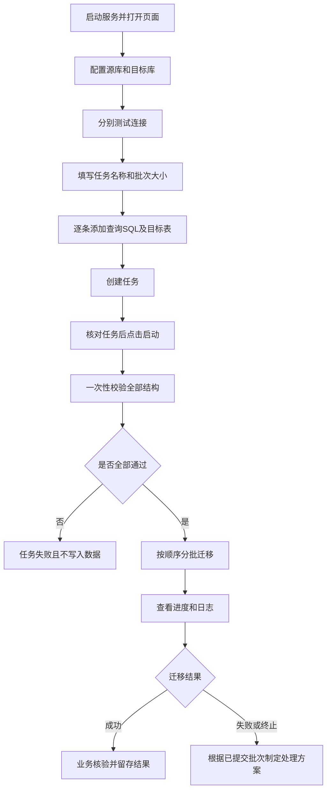
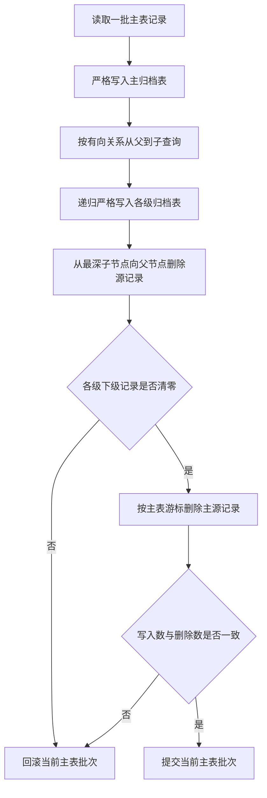

# Light DB Migration 现场实施操作手册

## 1. 文档目的

本手册供现场实施、运维和交付人员使用，用于在 MySQL、Oracle、达梦数据库之间按查询 SQL 分批迁移数据，或在同一数据库内将主业务表及其关联子业务表转移到归档表后清理源记录。工具不依赖存储过程，数据库连接和任务配置均在网页中填写，不需要修改服务端配置文件。

工具以轻量、易部署、易操作、易观察为目标。目标表或归档表需要提前建好；工具不自动建表、不修改表结构，也不提供执行后的自动恢复功能。

## 2. 使用前必须确认

开始前请逐项确认：

1. 已取得源库查询权限和目标表插入权限。
2. 目标表已经存在，字段定义能够容纳源查询结果。
3. 已明确本次迁移范围，并由业务或项目负责人确认查询 SQL。
4. 如果执行归档，已由业务负责人确认主表范围、全部子表关联关系、维护窗口和恢复方案，并已完成可用备份。
4. 重要数据已经按现场制度完成备份或具备数据库侧恢复手段。
5. 运行工具的机器能访问两端数据库地址和端口。
6. 已取得匹配现场操作系统和 CPU 架构的完整交付 ZIP，解压后保留其中的 `runtime/` 目录；无需安装 Java 或配置环境变量。
7. 目标库可用空间、归档日志空间和事务日志空间充足。

> 注意：工具的“终止”只会停止后续批次，已经提交成功的批次不会自动删除。第一版不提供一键回滚。

## 3. 部署包组成

标准发布目录如下：

```text
LightDbMigration/
├─ light-db-migration.jar    # 可执行服务
├─ start.bat                 # Windows 启动脚本
├─ start.sh                  # Linux 启动脚本
├─ runtime/                  # 当前平台的 Java，含 bin、运行库及原有许可证
├─ README.md                 # 项目能力、启动地址和第一版边界
└─ docs/
   ├─ 现场实施操作手册.md
   ├─ 开发人员设计说明.md
   ├─ 现场实测报告.md
   └─ 变更审阅清单.md
```

开发人员在具备 JDK 8、Maven 3.6.3+ 且 Maven 已加入 `PATH` 的源码环境执行 `build.bat`（Windows）或 `sh build.sh`（Linux），也可执行原命令 `mvn clean package -DskipTests`，然后直接交付 `target/light-db-migration-<项目版本>.zip`。该压缩包已经按上述目录组成生成，不需要再手工复制 Jar、Java、脚本或文档。Windows 和 Linux 的运行环境不能通用，必须领取对应操作系统、CPU 架构的交付包。

打包脚本自动定位源码项目目录，调用 `PATH` 中的 `mvn.cmd` 或 `mvn`，执行 `-B clean package -DskipTests` 并透传额外 Maven 参数。例如 `build.bat "-Dbundled.java.home=D:\delivery\jdk 8" -o` 或 `sh build.sh "-Dbundled.java.home=/opt/delivery/jdk 8" -o`；`-o` 仅适用于依赖和插件已缓存的开发环境。脚本失败返回 Maven 原始退出码且不提示成功，不暂停等待按键。`-h`、`--help`（Windows 另支持 `/?`）可查看帮助，无需 Maven。

`build.bat`、`build.sh` 只供开发人员在源码仓库打包，不进入现场 ZIP。实施人员解压交付包后使用 `start.bat`、`start.sh` 启动。

Java 运行环境随包携带，数据库驱动和网页资源已经打入 Jar，不需要另行安装 JDK、Maven、Tomcat、Node.js、MySQL 客户端或 Oracle 客户端，启动时也不需要联网下载依赖。`data/` 和 `logs/` 会在运行、保存配置或写日志时自动生成，不放入初始交付包，也不要放入代码仓库。

启动时优先使用包内 Java；若提示运行环境不完整或平台不匹配，请重新解压对应平台的完整交付包，避免只复制 Jar 和启动脚本。

## 4. 启动与停止

### 4.1 Windows 启动

1. 把发布目录复制到本机普通目录，路径中尽量不要使用特殊字符。
2. 使用默认 8088 端口时双击 `start.bat`；需要指定端口时在命令行执行 `start.bat 18088`，其中 `18088` 可替换为 1～65535 范围内的未占用端口。
3. 脚本会尝试打开 `http://127.0.0.1:<实际端口>`；等待命令窗口出现启动成功日志后访问，必要时刷新页面。
4. 若浏览器未自动打开，请手工输入上述地址。

不要关闭命令窗口。关闭窗口或按 `Ctrl+C` 会停止服务，内存中的任务状态和页面日志随之清空；已经加密保存的最近数据库配置会保留。

### 4.2 Linux 启动

首次赋予脚本执行权限：

```bash
chmod +x start.sh
```

前台启动：

```bash
./start.sh
```

指定端口启动：

```bash
./start.sh 18088
```

从其他机器访问时使用 `http://服务所在机器IP:<实际端口>`，并提前确认主机防火墙和现场网络策略允许该端口访问。不要直接把服务端口开放到互联网。

### 4.3 正常停止

1. 确认页面中没有处于“迁移中”“结构校验中”“排队中”“已暂停”状态的任务。
2. 若仍有任务，先点击“终止”，等待状态变为“已终止”。
3. 回到启动窗口，按 `Ctrl+C` 停止服务。

## 5. 页面操作总流程



该流程图使用 Mermaid 8.3 可兼容语法。

## 6. 数据库配置说明

源库和目标库的字段相同，每个任务都可以填写不同配置。

| 页面字段 | MySQL | Oracle | 达梦（DM） | 说明 |
|---|---|---|---|---|
| 数据库类型 | MySQL | Oracle | 达梦（DM） | 必选 |
| 主机地址 | 数据库服务器地址 | 数据库服务器地址 | 数据库服务器地址 | 支持 IP 或可解析主机名 |
| 端口 | 默认 3306 | 默认 1521 | 默认 5236 | 以现场实际配置为准 |
| 数据库名 / 服务名 / Schema | 数据库名 | 服务名或 SID | 可选 Schema | Oracle 需选择连接方式；DM 留空使用登录用户默认模式，填写时转大写 |
| 用户名 | 查询或写入用户 | 查询或写入用户 | 查询或写入用户 | 建议使用最小权限账号 |
| 密码 | 数据库密码 | 数据库密码 | 数据库密码 | 最近配置中加密落盘；不写日志 |
| JDBC URL | 可选 | 可选 | 可选 | 高级用法，填写后覆盖主机、端口等组合配置 |

Oracle 常用连接方式：

- 服务名：对应 `jdbc:oracle:thin:@//主机:端口/服务名`。
- SID：对应 `jdbc:oracle:thin:@主机:端口:SID`。

达梦不填写 Oracle 服务名或 SID。常用连接为 `jdbc:dm://主机:5236`；指定模式时可用 `jdbc:dm://主机:5236?schema=模式名`。目标表和归档表支持 `表名` 或 `模式名.表名`，普通标识符转为大写；其他高级连接参数通过 JDBC URL 配置。达梦的普通迁移可跳过唯一键重复，严格写入及归档遇冲突会回滚当前批次。实际验证记录见 [达梦适配实测报告](达梦适配实测报告.md)。

达梦目标表或归档表使用 `IDENTITY` 自增列时，工具会在当前连接开启显式赋值以保留源 ID，不需要现场改表；任务连接关闭后自动恢复。CLOB/BLOB 和空值已在本次达梦环境验证。

配置完成后，分别点击源库和目标库的“测试连接”。页面显示数据库产品、版本和耗时即表示连接成功。连接失败时先核对地址、端口、账号、网络和 Oracle 服务名/SID；不要连续盲目重试，避免触发现场账号锁定策略。

确认两端输入无误后可点击“保存当前配置”。服务也会在创建任务时自动更新最近配置。下次刷新页面或重启服务会自动回填，包括密码；不再需要时点击“清除记忆配置”。

## 6A. 配置导入与导出

开发人员可以在公司完成迁移或归档规则配置，导出后交付现场使用，不需要把开发环境数据库连接带到现场。

1. 开发人员选择任务类型，填写任务名称、批次大小和本次规则，在规则区点击“导出配置”，保存 JSON 文件。只导出当前选择的任务类型及其规则。
2. 现场打开工具，点击“导入配置”，选择开发人员提供的 JSON 文件，文件上限为 5 MiB。
3. 导入成功后，页面自动切换为文件中的任务类型，并替换当前任务名称、批次和规则。迁移规则包含各步 SQL、目标表、游标及写入方式；归档规则包含全部主表、多级从表、节点上级及关联字段。
4. 保留或填写现场数据库连接，核对 SQL 的业务范围、表名、关联关系和批次大小，再测试连接。归档必须重新完成备份与删除范围核对，并勾选删除源记录确认。
5. 核对后手工创建任务，在任务列表复核后启动。导入本身不会创建或启动任务，也不会连接数据库。

导出文件不包含任何源库或目标库连接字段，包括数据库类型、地址、端口、库名/服务名、Oracle 连接方式、用户名、密码和 JDBC URL。即使导入文件中额外携带连接字段，工具也会忽略；页面现有连接和本机加密记忆配置均不覆盖。

任务执行状态、进度、日志和归档删除确认也不导出。导入后归档删除确认会取消勾选，原有任务列表不受导入影响。格式、版本、批次或归档关系校验失败时，页面提示原因并保留导入前的规则；请先修正文件或联系开发人员重新导出。

配置文件包含明文 SQL、表名和业务条件。交付前请检查这些内容，避免在 SQL 注释、任务名或查询条件中夹带不应交付的信息。

## 7. 迁移 SQL 配置

### 7.1 一个任务配置多条 SQL

点击“添加一条 SQL”可增加迁移步骤。同一任务内的 SQL 按页面从上到下逐条执行。启动后，工具会先校验全部步骤；只有全部结构校验通过，才会开始第一条 SQL 的数据写入。

每个步骤需要填写：

- 步骤名称：用于页面进度和日志识别。
- 目标表：支持 `表名` 或 `模式名.表名`，目标表必须已经存在。
- 递增唯一游标字段：可填写数据库自增主键，也可填写应用生成的递增 UUID/ID；不使用游标分页时留空。
- 写入方式：默认“跳过重复数据”，也可选择“普通插入”。
- 源数据库查询 SQL：只允许单条 `SELECT` 或 `WITH` 查询。

### 7.2 SQL 编写规则

推荐显式列出字段并使用清晰别名：

```sql
SELECT
    ID,
    CUSTOMER_NAME,
    CREATED_AT
FROM SOURCE_CUSTOMER
WHERE CREATED_AT < TIMESTAMP '2026-08-29 00:00:00'
```

请遵守以下规则：

1. 查询结果字段名或别名必须能在目标表找到，不区分大小写。
2. 查询结果中不能存在重复字段名或重复别名。
3. 不要使用 `SELECT *` 迁移长期演进的业务表，避免源表新增字段后改变迁移含义。
4. 第一版不支持 `?` 占位参数，筛选值需要直接写在 SQL 中。
5. 每个步骤只允许一条 SQL，不要使用分号拼接多条语句。
6. 不要在查询 SQL 中执行更新、删除、建表或调用存储过程。
7. 查询中若使用数据库专有函数，必须符合源数据库语法。

### 7.3 结构校验规则

工具在写入前执行以下检查：

- 查询能够在源库解析，并能读取查询结果字段元数据。
- 目标表存在且可访问。
- 每个源查询字段在目标表中都有同名字段。
- 比较源定义映射为目标数据库方言后的类型、长度、精度、小数位和可空性；目标更宽或本次数据可以写入，也不视为字段定义完全一致。
- 源可空而目标非空、源非空而目标可空均属于字段差异；即使类型和长度相同也单独报告并生成同步语句。
- 目标未出现在源查询结果中的字段属于多余字段，给出删除列语句；一个迁移步骤的源字段集合以该条查询结果为准。
- 固定整数等类型仍保留本次数据范围检查，但不会用“当前数据可以写入”替代字段定义对齐。
- 页面配置的游标字段必须出现在查询结果中；不检查数据库自增标记和数值类型，但会在同一次统计中确认本次结果非空且唯一。

校验依据是“源查询结果结构”与“目标表结构”。若查询包含连接、表达式或字段转换，请通过别名和显式转换让结果结构与目标表一致。

该规则适用于 MySQL、Oracle、达梦。工具先描述原始查询，再对来源明确的字段补读物理定义；MySQL 的 ENUM/SET 成员和浮点参数也参与比较，差异不会只显示为注释。查询表达式确实没有可用的类型精度时，请按日志提示增加显式 CAST；无法读取元数据或 SQL 本身无效，需要先处理查询或权限。

校验发现问题后不会在第一处停止：工具会继续检查当前步骤的其他字段，并继续校验任务中的后续 SQL。全部检查结束后，任务日志按编号一次性输出所有已发现问题。用户主动终止、线程中断或数据库连接不可继续使用时仍会立即停止。

### 7.4 表结构同步建议脚本

结构校验失败后，打开该任务的“查看日志”，页面下方会显示“表结构同步建议脚本”，可以复制或下载为 `.sql` 文件。

脚本可能包含：

- 目标表缺少字段时的 `ALTER TABLE ADD`。
- 字段类型、长度、精度、小数位或可空性不同时的 `ALTER TABLE MODIFY`，包括放宽/收紧非空约束和收窄字段容量。
- 目标表多余字段的 `ALTER TABLE DROP COLUMN`。
- 明确确认目标表不存在时的候选 `CREATE TABLE`。
- 非字段定义问题或元数据不足的明确说明，例如重复别名、游标配置错误、无法读取字段元数据。同一物理目标的源定义互相矛盾时列出冲突候选，不输出相互覆盖的执行语句。

使用限制：

1. 生成脚本后不会直接执行。审核完成后可点击“执行脚本”，在确认框核对任务、目标库和执行风险，再确认执行；取消确认不会提交执行请求。
2. 执行前必须备份目标表，并由开发人员或 DBA 审核。
3. 脚本依据源查询结果元数据推导，归档依据源物理表。生成建表、加字段或改字段建议时，携带可确认的源默认值，如 `DEFAULT ' '`（一个空格）、`DEFAULT '0'`、`DEFAULT 0`。仅默认值不同不会单独触发结构差异；主键、唯一索引、普通索引和字段注释仍需人工核对。来源未知、默认值读取失败或跨库无法可靠转换时，脚本会说明人工处理方向。
4. 工具按源定义生成 `NULL/NOT NULL`、容量收窄及 `DROP COLUMN`，不分析历史数据后再决定是否给脚本；请在执行前人工确认。数据库实际约束仍可能使 DDL 执行失败，工具不会自动删除主键、外键或其他约束来强制通过。
5. MySQL `MODIFY COLUMN` 按可确认的源默认值生成，仍可能覆盖目标的 `COMMENT`、字符集等其他属性；源无默认值时也可能清除目标默认值。必须先执行 `SHOW CREATE TABLE` 核对。Oracle/达梦源无默认值时，不额外清除目标已有默认值。
6. Oracle 字段类型变更仍受目标表现有数据和约束影响，需要在测试环境先验证。

源列没有合适的默认值时，不能凭空补空格或零；在非空目标表中增加 `NOT NULL` 列仍可能失败。修改已有列为 `NOT NULL` 时，默认值也不保证填充历史 NULL，需先由 DBA 核对处理。跨库空串、国家字符集字面量、反斜杠以及未确认的函数或序列默认值均须人工处理，不能直接照搬。详见[默认值修复报告](源默认值同步修复报告.md)。

### 7.5 在页面执行结构脚本

打开结构校验失败任务的“查看日志”，在脚本区域点击“执行脚本”。按钮仅在脚本包含可执行 DDL、任务已失败且本份脚本尚未执行时可用；只有问题说明或人工处理注释的脚本仍可复制、下载。

确认框会显示任务名称和该任务目标数据库。执行前请将页面数据库连接恢复为创建该任务时的目标连接：普通迁移使用“目标数据库”，归档使用“源数据库”。失败任务内存中的密码已经清除，因此执行时读取页面当前填写的账号密码；后端同时核对数据库类型、地址和用户与原任务一致。连接不匹配时不执行。

再次确认后，工具按脚本顺序执行未被注释的建表和字段增改删建议，并在日志中显示每条结果及完成条数。删除只允许单条 `ALTER TABLE ... DROP COLUMN ...`，不执行删表、删约束或客户端自定义 SQL。原脚本文本只读，服务端只执行该任务已生成且摘要一致的脚本。

执行中按钮禁用，同一份脚本不重复执行。遇到连接或 SQL 错误立即停止，不自动重试；已经成功的 DDL 可能已经生效，不能依赖事务回滚。页面断网或请求超时时，请刷新该任务日志确认状态，不要重复提交。部分执行失败后，先核对已生效改动，再重新创建任务获取当前差异。

脚本执行结束不会自动启动数据迁移或归档，也不会把原失败任务改成迁移成功。请核对执行结果，处理剩余人工项目，再从当前表单重新创建任务并校验。

## 7A. 数据归档配置与执行

### 7A.1 适用场景

归档模式用于“源表与归档表位于同一个数据库，表结构相同，归档成功后清理源记录”的场景。一个任务支持一到多张主业务表，以及零到多张关联子业务表。每张主表是一棵归档关系树的根。

归档与迁移都先一次性检查本任务全部配置表。某张主表或父表存在结构差异时，仍继续检查其他主表和全部子表；字段数量不同时继续列出缺失、多余及定义不同的字段。检查完成后，日志统一列出问题，日志下方同时显示可复制、下载的“表结构同步建议脚本”。只要结构预检有问题，就不会开始归档写入和源数据删除。

归档建议以源物理表字段为依据；所有真实字段差异均生成对应 DDL，包括可空性、容量收窄、缺字段和多余字段。经开发/DBA 审核后，可复制到数据库客户端处理，或按第 7.5 节在页面二次确认后执行；完成后重新创建任务。Oracle/达梦派生查询返回 `NUMBER(0,-127)` 等未知数值精度时，不把它当成物理表字段差异；已知类型/精度错误仍拒绝。主键、索引、默认值、注释等仍需另行核对。连接故障、用户终止和线程中断会立即停止；元数据不可读取时只能报告该表不可检查的原因，不能列出其全部字段差异。

日志中的“归档查询字段类型与源表不同”比较的是归档范围 SQL 的查询元数据与源表字段，不是源表与归档表的物理结构。对于未知数值精度 `(0,-127)`，更新后应看到节点级兼容说明，不应为此生成改表语句。若源物理表与归档物理表确有精度或可空性差异，仍会逐项提供 `ALTER TABLE`。

不支持以下用法：

- 跨数据库归档后删除源数据；
- 只归档源表的部分字段；
- 使用目标重复忽略模式；
- 归档表尚未创建或与源表结构不一致；
- 从表无法通过明确字段关系关联到主表或另一张已配置从表。
- 从表关系存在上级节点缺失、自关联或循环。

### 7A.2 页面配置步骤

1. 在“任务类型”选择“数据归档”。页面只保留一个“归档数据库”连接配置。
2. 默认已有一张主业务表；如需归档其他独立业务主表，点击“添加主业务表”。按页面顺序为每张主表填写源表、归档表和归档范围查询 SQL。递增唯一游标字段可以留空：填写时按固定上界 Keyset 分页；留空时读取完整主键（支持任意列数的复合主键）作为排序和精确删除键，每批删除后重新读取当前首批，不把主键假定为递增字段。
3. 主表查询必须返回源表全部字段。建议使用显式字段清单；如使用 `SELECT *`，必须确认执行期间源表结构不会变化。
4. 按需添加从业务表。每张从表会获得只读节点标识，例如 `CHILD_1`。
5. 为每张从表选择直接上级节点。上级可以是任一 `MAIN_n` 主表，也可以是另一张从表；页面顺序不要求父节点在前，后端会执行拓扑排序。存在多张主表时不得省略上级节点。
6. 填写关联字段映射。等号左侧是本表字段，右侧是所选上级表字段；多字段关联用逗号分隔。
7. 将每批行数设置在 `1` 到 `500`。每一级从表都可能继续分页并扩展下一级数据，应结合关系深度和单条上级记录的数据量评估。
8. 勾选“我已完成备份并确认删除源记录”，创建任务。
9. 在任务列表再次核对主表范围、节点上级、源表/归档表、字段映射和批次大小，再点击“启动”；启动归档还会弹出最后一次删除确认。

主表配置示例：

```sql
SELECT ID, TENANT_ID, BUSINESS_NO, CREATED_AT, STATUS
FROM BUSINESS_MAIN
WHERE CREATED_AT < '2025-01-01'
  AND STATUS = 'FINISHED'
```

主表 `MAIN_1` 到一级从表 `CHILD_1` 的关联映射示例：

```text
MAIN_ID=ID
```

一级从表 `CHILD_1` 到二级从表 `CHILD_2` 的配置示例：

```text
CHILD_2.parentNodeId = CHILD_1
CHILD_2 字段映射：CHILD1_ID=ID
```

复合关联示例：

```text
TENANT_ID=TENANT_ID, BUSINESS_NO=BUSINESS_NO
```

从表不需要重复填写 `CREATED_AT` 或 `STATUS` 条件。工具从当前上级节点批次提取右侧字段值，通过参数化 SQL 查询匹配的下级记录，再继续沿有向关系向下处理；字段值不会拼接进 SQL 文本。

### 7A.3 每个主表批次的事务顺序



该顺序兼容多级外键，例如 `主表 → 从表A → 从表B`：归档侧依次写主表、A、B，源侧依次删除 B、A、主表。多张主表按页面顺序依次进入该流程。每一批使用同一个 JDBC 连接和本地事务；目标重复键、字段结构不一致、图关系不合法、写入失败、删除数量不一致、仍有下级记录或终止请求都会使当前未提交批次回滚。此前已提交的其他主表或批次不会随之后的失败回滚。

### 7A.4 归档前必须确认

- 归档表不是视图、临时表或源表本身，并且不存在源表/归档表交叉复用。
- 页面填写游标时，主表查询结果和每张从表关联结果中的游标字段均须非空、唯一且按新增顺序递增。页面留空时应确认源表存在主键；单列主键或任意列数的复合主键都只作为稳定排序和精确删除键，不参与 `MAX / > / <=` 游标分页。没有主键时必须手工填写游标字段。
- 每张从表只有一个直接上级节点，所有从表最终都能沿上级关系回到某个 `MAIN_n` 主表；一个父节点可以分支关联多张下级从表，不允许两个主表共同指向同一个从表节点。
- 主表查询结果确实来自填写的主业务源表。工具会校验字段结构，但无法判断 SQL 的业务语义是否正确。
- 归档表不存在本次范围的重复数据；归档使用普通严格插入，任何唯一键冲突都会失败。
- 执行期间业务已停写或进入维护窗口。按批次提交可以控制事务规模，但不能替代业务停写。
- 已完成数据库级备份，且恢复步骤已经过 DBA 审核。

### 7A.5 失败、终止和重跑

- 当前主表批次发生错误时会整体回滚；此前已经成功提交的批次不会自动恢复。
- 点击终止后，工具会取消当前 JDBC 操作；若终止发生在提交前，当前批次回滚，已提交批次保留。
- 目标重复键通常表示归档表已有同键数据或上一次提交范围未被正确排除。不要切换为“忽略重复”后重跑；应先核对源表、归档表和任务日志。
- 重跑前先分别统计源表剩余范围、归档表已归档范围及各子表数量。主表查询只会读取仍在源表且满足条件的记录，正常已提交批次已从源表删除，不会再次进入查询。

### 7A.6 归档完成后的核验

至少执行以下核验，并将实际表名和条件替换为本次配置：

```sql
-- 1. 主表本次条件应无剩余记录
SELECT COUNT(*) AS MAIN_REMAIN
FROM BUSINESS_MAIN
WHERE CREATED_AT < '2025-01-01'
  AND STATUS = 'FINISHED';

-- 2. 归档主表数量与执行前确认数量一致
SELECT COUNT(*) AS MAIN_ARCHIVED
FROM BUSINESS_MAIN_HIS
WHERE CREATED_AT < '2025-01-01'
  AND STATUS = 'FINISHED';

-- 3. 检查是否仍有本次归档主键对应的源子表记录
SELECT COUNT(*) AS CHILD_REMAIN
FROM BUSINESS_DETAIL D
WHERE EXISTS (
    SELECT 1
    FROM BUSINESS_MAIN_HIS M
    WHERE D.MAIN_ID = M.ID
      AND M.CREATED_AT < '2025-01-01'
      AND M.STATUS = 'FINISHED'
);

-- 4. 对比主、子归档表的关键业务字段和抽样记录
SELECT * FROM BUSINESS_MAIN_HIS WHERE ID IN (/* 本次抽样主键 */);
SELECT * FROM BUSINESS_DETAIL_HIS WHERE MAIN_ID IN (/* 本次抽样主键 */);
```

页面“已归档/已删除源记录”是执行过程统计。正式结果必须以数据库独立 SQL 核验为准。

归档具体 SQL 只写入服务端 SLF4J 后台日志，前端任务日志不展示 SQL。后台以 `SQL执行[操作]` 标识：普通参数化查询打印 SQL 文本和绑定参数；批量归档写入打印 SQL 模板与批量行数，不逐行展开完整业务字段。删除键参数最多展示前 50 个，超长字符串会截断并标明总参数数。

## 8. 分批与分页机制

### 8.1 批次大小

默认每批 1000 行，可配置 1 至 10000 行。

- 普通窄表可从 1000 开始。
- 包含 CLOB、BLOB 或大文本时建议先使用 100 至 500。
- 网络延迟较高且单行较小时可适当增大，但必须观察源库、目标库和服务内存。
- 每批单独提交，批次越大，单次事务占用的资源越多。

### 8.2 无自增主键

游标字段留空时，工具对该步骤执行一次源查询，通过 JDBC 流式读取结果，并按批次写入目标库。该方式不在循环中反复执行分页 SQL，也不会因 `OFFSET` 增大而逐页变慢。

### 8.3 使用递增唯一游标字段

如果源查询结果包含适合排序分页的递增唯一字段，应填写“递增唯一游标字段”。该配置以页面输入为准，不检查数据库字段是否声明自增，也不限制为数值类型。因此，数据库自增主键、应用服务生成的递增字符串 ID，以及可按数据库顺序持续递增的 UUID/编码都可以配置。工具会：

1. 在结构预检的总数统计中同时检查游标字段非空且唯一。
2. 查询本次迁移开始时的最大游标值作为固定上界。
3. 每批使用 `游标 > 上批最大值 AND 游标 <= 固定上界` 查询。
4. 按数据库对该字段的升序规则读取下一批。

该方案不会迁入任务启动后新增且超过固定上界的数据，能避免大表深分页性能下降。页面认可配置不代表工具替业务判断“递增”语义：字段必须在本次查询结果中非空、唯一，且后续值能够按照源数据库的比较和排序规则持续增大。普通随机 UUID 不适合作为游标；应用算法生成的单调递增 UUID/ID 可以使用。

## 9. 重复数据处理

默认写入方式为“跳过重复数据”：

- MySQL 目标库使用 `INSERT IGNORE` 批量写入。
- Oracle 目标库优先读取目标表主键或唯一键，通过 `MERGE ... WHEN NOT MATCHED THEN INSERT` 批量写入。
- Oracle 目标表缺少可用的完整主键/唯一键，或批量写入发生并发重复键时，当前批次回滚后逐行识别 `ORA-00001` 并跳过重复行。

“跳过重复”只表示对目标库现有唯一约束的冲突进行处理，不会替代业务去重规则。目标表若没有唯一约束，数据库无法识别业务重复。

选择“普通插入”后，任一重复键或其他写入错误都会使当前批次回滚并将任务置为失败。

## 10. 创建、启动与多任务

点击“保存当前配置”会把两端配置（含密码）加密保存在服务本机；创建迁移任务时也会自动更新这份最近配置。点击“创建迁移任务”本身不会连接数据库或写入数据，创建完成后应在任务列表中再次核对：

- 源库和目标库类型、地址是否正确。
- 批次大小是否合理。
- SQL 条数和目标表是否符合本次范围。

核对后点击“启动”。服务最多同时运行 4 个任务，超出的任务显示“排队中”。不同任务可使用完全不同的数据库配置。现场应结合数据库承载能力控制并发数量，不建议在同一目标表上同时启动多个写任务。

## 11. 进度、日志和任务状态

### 11.1 进度指标

启动任务时会对每条查询执行总数统计，用于显示总进度。页面分别显示：

- 已处理：已经从源库读取并完成当前批次写入处理的行数。
- 写入：数据库驱动明确报告的成功写入行数。
- 跳过：数据库驱动明确报告的重复跳过行数。
- 批次数：已经提交的批次数。

部分 MySQL 批处理场景只返回“执行成功但无精确行数”，此时“写入/跳过”是驱动可报告的近似值，最终数据量应以数据库查询核验为准；“已处理”和任务完成状态仍用于反映迁移进度。

### 11.2 状态说明

| 状态 | 含义 |
|---|---|
| 待启动 | 已创建但尚未访问数据库 |
| 排队中 | 等待可用迁移线程 |
| 结构校验中 | 正在连接、读取元数据和统计数据量 |
| 迁移中 | 正在读取或写入数据 |
| 等待暂停 | 已收到暂停请求，等待当前数据库操作或批次结束 |
| 已暂停 | 已停在安全批次边界，可继续或终止 |
| 终止中 | 正在取消当前数据库操作 |
| 已终止 | 不再处理后续数据，已提交批次保留 |
| 已完成 | 全部步骤执行成功 |
| 失败 | 结构、查询、连接或写入发生错误 |

### 11.3 日志

点击任务卡片的“查看日志”可查看连接、校验、分页方式、每批统计、暂停/继续和异常信息。页面日志最多保留每个任务最近 5000 条；服务级日志滚动保存在：

```text
logs/light-db-migration.log
```

每个成功提交的批次都会输出类似日志：

```text
步骤 客户任务 完成第 3 批：读取 1000 行，写入 998 行，跳过 2 行，批次总耗时 1260 ms（目标写入及提交 430 ms）
```

- “批次总耗时”包含该批源端查询/读取、行数据组装、目标写入及事务提交时间。
- “目标写入及提交”只统计目标端 JDBC 批量写入和提交；Oracle 批量写入遇到重复键后回退逐行识别的时间也计入其中。
- 暂停操作在批次边界的等待时间不计入下一批耗时。
- 如果总耗时明显偏高但目标写入耗时较低，优先检查源库查询、源库负载和源端网络；如果两项都高且差值较小，优先检查目标库锁、索引/约束、事务日志、网络和数据库负载。

日志不会主动打印数据库密码和完整查询 SQL。向开发人员反馈问题时，建议同时提供任务 ID、失败时间、步骤名称、页面错误日志和服务日志对应片段。

## 12. 暂停、继续和终止

- 暂停：点击后等待当前查询或写入批次结束，再进入“已暂停”。不会强制切断正在提交的批次。
- 继续：从下一个未处理批次继续。
- 终止：尝试取消当前 JDBC 操作，并停止后续批次。已经成功提交的批次不会回滚。
- 清除：只删除页面中的内存任务记录，不删除目标库数据。运行中的任务必须先终止。

如果迁移失败或被终止，必须先依据日志和目标表实际数据量确认已经写入的范围，再由项目负责人决定继续补迁、人工清理或从备份恢复。不要在范围不明时直接重跑普通插入任务。

## 13. 迁移完成后的核验

至少完成以下核验：

1. 对源查询和目标表使用相同业务条件分别执行 `COUNT(*)`。
2. 按主键范围、日期或业务分区抽查多段数据，而不是只看首尾几行。
3. 对关键金额、数量字段执行汇总比对。
4. 检查目标表主键/唯一键冲突是否符合预期。
5. 检查目标库错误日志、表空间、事务日志或归档日志是否正常。
6. 保存任务完成截图、任务 ID、SQL 版本和核验结果。

跨 MySQL/Oracle 迁移时，重点检查日期时间、字符集、空字符串、超长文本、二进制、大数精度和大小写字段名。

## 14. 常见问题处理

### 14.1 页面打不开

- 查看启动窗口是否已显示服务启动成功。
- 确认访问地址使用启动脚本显示的实际端口；未传端口参数时才是 `8088`。
- 执行 `java -version`，确认 Java 可用。
- 从其他机器访问时检查服务主机防火墙和网络路由。
- 查看 `logs/light-db-migration.log` 是否有端口占用信息。

### 14.2 数据库连接失败

- 核对数据库类型、地址、端口、库名或服务名/SID。
- 确认账号未锁定且具备登录权限。
- Oracle 重点区分服务名与 SID。
- 从服务所在机器检查数据库网络连通性。
- 登录失败后不要连续重试，先找数据库管理员核实。

### 14.3 结构不一致

根据错误中给出的字段检查：

- 查询字段是否漏写别名。
- 目标表字段是否存在。
- 字符长度或数值精度是否偏小。
- 目标非空字段是否缺失且没有默认值。

查看日志末尾的完整问题清单，并审核页面生成的表结构同步建议脚本。三种数据库的真实字段差异均应对应建表或增改删列语句，包括双向非空调整；不会因历史数据而省略。查询别名、游标设置、关联配置、不可读取的元数据和互相矛盾的源定义不是可单靠修改目标字段解决的问题，日志及脚本注释会说明处理方向。

修改目标表前按项目变更流程审核；可以复制脚本人工执行，或按第 7.5 节在页面二次确认后执行。

### 14.4 进度长时间不变

先看当前状态和最后一条日志：

- “结构校验中”可能正在执行源查询总数统计；存在可能缩窄的固定整数列时，同一次统计还会计算这些列的最小值、最大值和必要的小数值数量。
- “迁移中”可能正在执行大批量查询、网络传输或目标库提交。
- 检查源库慢 SQL、目标库锁等待、网络质量和数据库资源。
- 需要停止时点击“终止”，等待数据库驱动返回取消结果，不要直接反复关闭和重启服务。

### 14.5 Oracle 重复数据处理变慢

日志若提示“回退逐行识别”，说明目标表没有可用于 `MERGE` 的完整主键/唯一键，或批次内出现并发冲突。核对目标表约束和源查询是否包含完整唯一键。不要为了提速临时移除业务约束。

## 15. 安全与使用边界

- 仅在受控现场网络中运行，不对公网开放。
- 使用最小权限数据库账号：源库只读，目标库仅授予本次目标表所需权限。
- 不要在任务名称、SQL 注释或截图中写密码。
- 最近一次两端配置在点击“保存当前配置”或创建任务时写入 `data/last-database-config.dat`，密码包含在 AES-GCM 密文中；刷新页面或重启服务后会自动回填。
- 密钥 `data/last-config.key` 与密文位于同一台机器，主要防止误查看和普通文本扫描，不能抵御已经取得该目录读取权限的本机用户。应使用受控账号运行服务并限制发布目录权限。
- 不再需要记忆配置时点击“清除记忆配置”，工具会删除本机密文和密钥。不要手工只删除其中一个文件，否则剩余文件无法恢复。
- 配置导出仅保存当前模式的任务规则，不包含数据库连接；配置导入不会更新页面连接或本机记忆配置，归档删除确认必须重新勾选。
- 服务停止或重启后，任务、页面日志和进度状态全部丢失；最近数据库配置和滚动文件日志仍保留。
- 第一版不支持断点持久化、自动建表、自动改表、存储过程、迁移后自动回滚或数据恢复。

## 16. 现场交付记录建议

每次迁移建议记录：

- 工具版本和 Jar 校验值。
- 源库、目标库的环境名称和脱敏地址。
- 任务 ID、任务名称、执行人、开始/结束时间。
- 每条 SQL 的受控文档编号或版本，不在公开材料中粘贴敏感条件。
- 批次大小、游标字段、写入方式。
- 页面最终状态、源/目标核验 SQL 和核验结果。
- 异常、暂停、终止以及人工处置记录。

这些记录用于后续问题定位和交付审计，不应包含数据库明文密码。
